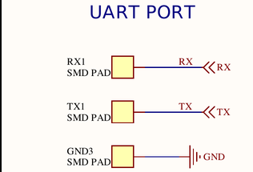
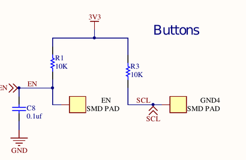
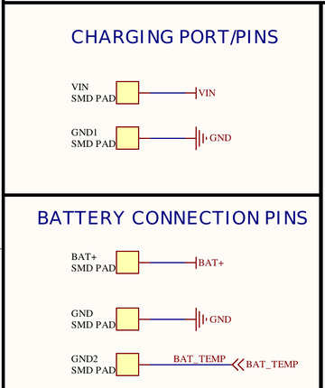
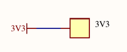
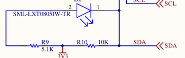

# HEALTH_FLEX_C3 ring board: first power-up and programming

This kit checks a freshly assembled ring flex board in one sitting. You check the rails
with a meter, put the ESP32-C3 into download mode by hand, flash a test program over a
3.3 V USB-UART adapter, and read one PASS/FAIL line per part off the serial port.

Everything here was read off the schematic `HEALTH_FLEX_C3_WITH_BMS.pdf` (Altium,
"HEALTH_FLEX_C3", sheet dated 30 Oct 2026, drawn by Rohan), by designator and pin number.
Datasheet sources are listed at the end. **The program has been compiled but has not yet run
on a flex board.** This is its first run, so a FAIL can mean a firmware mistake as well as
a board fault. Send back the whole serial log (see the end of this document).

Contents of the kit:

| File | What it is |
|---|---|
| `flex_bringup_kit.pdf` | this document |
| `flex_bringup/flex_bringup.ino` | the test program (ESP32 Arduino core only, no libraries), for Arduino IDE |
| `firmware/*.bin` | the same program, prebuilt, for flashing with esptool alone (section 5a); run the commands from the folder that holds `firmware/` |

## 1. What you need

- The flex board.
- A USB-UART adapter **with 3.3 V logic** (CP2102, CH340, FT232 set to 3.3 V). Only TX, RX
  and GND are used: the board has no auto-reset circuit, so DTR and RTS stay unconnected.
- A multimeter.
- A current-limited bench supply (preferred for the first power-up), or a charged
  single-cell Li-ion battery.
- Fine wire or pogo pins for the pads, and tweezers or a jumper wire for the two "button" pads.

## 2. The pads

The board has no buttons and no USB connector. GPIO18 and GPIO19, the C3's USB pins, are used
for the fuel-gauge alert and the charger enable. Everything goes through SMD pads. The
schematic names them as below. It does not show where they sit on the flex, so find them
by name on the silkscreen or the assembly drawing.

| Pad | Net | Goes to |
|---|---|---|
| **RX1** | RX | U3 pin 27, **U0RXD** (GPIO20), the chip's UART **input** |
| **TX1** | TX | U3 pin 28, **U0TXD** (GPIO21), the chip's UART **output** |
| **GND3** | GND | ground |
| **EN** | EN | U3 pin 7, CHIP_EN; R1 10 kΩ to 3V3, C8 100 nF to GND |
| **GND4** | **SCL = GPIO9** | U3 pin 15; R3 10 kΩ to 3V3. **Not ground, despite its name.** This is the BOOT pad |
| **VIN** | VIN | charger U2 (BQ25185) IN, the 5 V charging input |
| **GND1** | GND | ground |
| **BAT+** | BAT+ | battery +: charger BAT, fuel gauge U10 BATT |
| **GND** | GND | battery − |
| **GND2** | **BAT_TEMP** | charger TS/MR (via R2 0 Ω) and fuel-gauge THRM (via R28 0 Ω). **Not ground.** Leave it unconnected |
| **3V3** | 3V3 | the 3.3 V rail, for measuring |
| EGGP / EGGN | ECGP / ECGN | the electrodes (not used here) |

<p> </p>

<p> </p>

*Schematic excerpts. Left to right: UART pads; EN and BOOT ("GND4" = SCL = GPIO9) pads; power pads ("GND2" = BAT_TEMP); 3V3 pad.*

The pads are named from the chip's side: **RX1 is the chip's receive line**. So:

| Adapter | Board pad |
|---|---|
| TX | **RX1** |
| RX | **TX1** |
| GND | **GND3** |
| VCC / 3V3 / 5V | **not connected** |

**Do not power the board from the adapter**, and do not feed 3.3 V into the 3V3 pad. That pad is
the output of the buck-boost converter U9; power the board through BAT+ or VIN (section 3).

## 3. Power and rail checks (before flashing)

**Power path:** BAT+ → charger U2 (BQ25185) SYS → VSYS → buck-boost U9 (TPS631011) → **3V3**
→ linear regulator U11 (TC1015-1.8) → **1V8**. The 1V8 rail feeds the MAX30003 (AVDD,
DVDD, OVDD and its 32 kHz oscillator U5) and the MAX30102 (VDD). The ESP32-C3, MAX30205,
MPU6050 and the MAX30102's LEDs run from 3V3. VIN feeds the charger.

### 3a. Unpowered: look for shorts

With nothing connected, measure resistance from **3V3**, **BAT+** and **VIN** to GND.
A reading that rises slowly as the capacitors charge is normal. A reading that stays near
0 Ω is a short. Stop there and inspect the board before powering it.

### 3b. First power-up

Use one of these:

- **A (preferred): bench supply on BAT+ (+) and GND (−), 3.7 V, current limit about 100 mA.**
  The charger runs in battery-only mode and passes BAT+ to SYS (BQ25185 datasheet
  section 6.4).
- **B:** a charged Li-ion cell on BAT+ / GND.
- **C:** 5 V on VIN / GND1 with **no** cell on BAT+. The MAX17055 is powered from BAT+,
  so expect its check to fail in this case.

Do not connect VIN while a cell is on BAT+ until the hardware team has confirmed the
charger settings. R20 = 39 kΩ on ILIM/VSET falls between the 43 kΩ and 33 kΩ rows of the
BQ25185 table, which both set a charge voltage of **4.35 V** (datasheet Table 6-1). That
suits a 4.35 V cell, not a standard 4.2 V one. Never connect VIN while a bench supply is
on BAT+.

Measure:

| Where | Expect | If not |
|---|---|---|
| **3V3** pad to GND | about 3.30 V | 0 V on battery power: the charger may be in factory mode (SYS off). Apply 5 V to VIN once to wake it (BQ25185 section 6.3.8), then remove VIN. Otherwise check U9 and L1 |
| **1V8**: no pad. Probe C42 (at U11's output) or C15 / C10 (beside the MAX30003) | about 1.80 V | low: U11, or its SHDN pull-up R32 (no value printed on the schematic). **High** (above about 1.85 V): see the I²C note below |
| Supply current, bench supply | steady, well under the limit | at the limit: a short. Switch off |

The 1.75–1.85 V window is a working bound for bring-up, not a datasheet limit. The test
program measures the 1V8 rail again with the ESP32's ADC.

**I²C pull-ups go to two rails.** SDA and SCL are pulled up to 3V3 (R10, R3 10 kΩ; R18,
R15 and R24, R25 4.7 kΩ) and also to 1V8 (R14, R13 4.7 kΩ at the MAX30102). On an idle bus,
current flows from 3V3 into the 1V8 rail through R13 and R14. A linear regulator cannot sink
that current, so if the 1V8 loads draw less, the rail rises. Note the 1V8 reading before
and after flashing.

## 4. Download mode (by hand)

The ESP32-C3 enters download mode when **GPIO9 is low as reset is released**. GPIO2 (R6)
and GPIO8 (R10) are already pulled high, as the C3 needs. The board gives you GPIO9 on the
pad named **GND4**, and reset on the pad named **EN**.

1. Power the board, with the adapter wired as in section 2.
2. Connect **GND4** to ground (to GND3, for example) and **hold** it there.
3. Short **EN** to ground for about half a second, then release it.
4. Keep GND4 grounded for another half second, then release it.

The chip now waits in its ROM loader. If a terminal is open at 115200 baud, the ROM prints
a boot banner with **DOWNLOAD** in the boot-mode field and "waiting for download". The
chip stays in download mode until EN is pulsed again or the power is cycled.

**Run the sequence again before each esptool command.** On the reference board, a
probe run before the write left esptool's stub loaded and the write then failed. On this
board the safe habit is: download sequence, one esptool command, and the sequence again
before the next one.

To run the program afterwards: GND4 released, then pulse **EN** to ground once.

<p></p>

*D2: anode through R9 (5.1 kΩ) to 3V3, cathode on GPIO8 = SDA, which R10 (10 kΩ) also pulls up.*

## 5a. Flash with esptool (no build needed)

Install esptool (`pip install esptool`). The write command has the same form as the one we
use with esptool 5.3.1 on another ESP32-C3 board without auto-reset. The underscore spelling works in
esptool 4 and 5; esptool 5 also accepts `write-flash`, `no-reset` and so on. Replace
`PORT` with the adapter's port (`COM5`, `/dev/ttyUSB0`).

**Check the chip and its flash first:**

```
esptool --chip esp32c3 --port PORT --baud 115200 --before no_reset --after no_reset flash_id
```

The output should name an ESP32-C3 with its revision and give a flash manufacturer, a
device ID and a detected flash size, normally 4 MB. The schematic leaves the C3's flash pins
(U3 pins 18–24, VDD_SPI and SPI*) unconnected, so the board only works with a C3 that
**has flash in the package**. The marking should read ESP32-C3**FH4** / **FN4** / **FH4X** /
**FH8X**, not a plain "ESP32-C3" (Espressif datasheet v2.5, Table 1-1). A plain C3 has
no flash and the flash ID comes back empty.

**Then write** (download sequence again first):

```
esptool --chip esp32c3 --port PORT --baud 460800 --before no_reset --after no_reset \
  write_flash -z --flash_mode dio --flash_freq 80m --flash_size 4MB \
  0x0     firmware/flex_bringup.ino.bootloader.bin \
  0x8000  firmware/flex_bringup.ino.partitions.bin \
  0xe000  firmware/boot_app0.bin \
  0x10000 firmware/flex_bringup.ino.bin
```

(on Windows `cmd`, put it on one line without the `\`). If it fails partway, lower
`--baud` to 115200. Then pulse EN to run it.

## 5b. Or build and upload with Arduino IDE

1. Install the **esp32 by Espressif Systems** board package (Boards Manager). The images in
   `firmware/` were built with version 3.3.11.
2. Open `flex_bringup.ino` and set **Tools**:

   | Setting | Value |
   |---|---|
   | Board | **ESP32C3 Dev Module** |
   | USB CDC On Boot | **Disabled** (Serial must go to UART0, the RX1/TX1 pads) |
   | Flash Mode | **DIO** |
   | Flash Size | 4MB (32Mb) |
   | Partition Scheme | Default 4MB with spiffs |
   | Upload Speed | 460800 (115200 if uploads fail) |
   | Port | the USB-UART adapter |

3. Enter download mode (section 4), then click **Upload**. The IDE ends with a reset
   through RTS, which is not wired, so nothing happens: **pulse EN yourself**.
4. Open **Serial Monitor at 115200**.

The command-line equivalent, which made the images in `firmware/`:
`arduino-cli compile --fqbn esp32:esp32:esp32c3:CDCOnBoot=default,FlashMode=dio,FlashSize=4M flex_bringup`.

## 6. What the program does and what to expect

At 115200 baud, after EN:

1. **Chip**: model, revision, MAC, flash JEDEC ID and detected size.
2. **LED D2 blinks for 5 s** (10 blinks). D2's anode goes through R9 (5.1 kΩ) to 3V3 and
   its cathode to GPIO8, so **LOW = on**. At that resistor it carries well under 1 mA, so it
   is **dim**: shade it and look closely. GPIO8 is also SDA, so D2 also flickers faintly
   whenever the I²C bus is busy.
3. **I²C**: first the idle levels of SDA and SCL (both must read 1), then a scan on
   SDA GPIO8 / SCL GPIO9 at 100 kHz, with each address named:

   | Address | Part | Identity check |
   |---|---|---|
   | 0x57 | MAX30102 PPG (U7) | PART_ID register 0xFF = 0x15 |
   | 0x48 | MAX30205 temperature (U8), A0 = A1 = A2 = GND | configuration register and a plausible temperature (no ID register) |
   | 0x68 **or** 0x69 | MPU6050 IMU (U6) | WHO_AM_I 0x75 = 0x68. AD0 (U6 pin 9) is **not connected** on the schematic, so the address depends on how the floating pin settles; both count |
   | 0x36 | MAX17055 fuel gauge (U10) | DevName 0x21 printed (0x4010 on the first silicon; later silicon may differ) |

4. **1V8 rail** through the ADC on GPIO3. GPIO3 carries the MAX30102's interrupt line,
   which R17 pulls up to 1V8. The MAX30102 holds that line low after power-up until its
   status register is read, so the program reads it first, then measures.
5. **MAX30003 INFO register** over SPI (SCK GPIO4, MISO GPIO5, MOSI GPIO6, CS GPIO7). The
   datasheet fixes bits [23:20] = 0101 and [13:12] = 11; **bits [19:16] are the revision**; bits
   [11:0] vary from unit to unit. The reference board read **0x513261**, i.e. revision 1.
   PASS = the fixed bits match and two reads agree. A revision other than 1 still passes,
   with a note.
6. **MAX17055**: cell voltage and state of charge. The gauge has not been configured for the
   ring's cell, so treat the SOC as indicative only. The voltage should match a meter on
   BAT+ to within a few tens of mV.
7. A **RESULT** line per item and an **OVERALL** line. These repeat every 10 s; send `r` to
   run everything again, including the blink.

The output looks like this. The layout is real, but **the values here are placeholders,
not a capture**:

```
# ==== flex_bringup: HEALTH_FLEX_C3 power-up check ====
# chip: ESP32-C3, revision v0.4, 1 core(s), embedded flash: yes
# MAC (base, eFuse): xx:xx:xx:xx:xx:xx
# flash: JEDEC ID 0xXXXXXX, detected 4096 KB, image header says 4096 KB, mode 2 (2 = DIO)
# LED D2: blinking 5 s (2 Hz). It is dim: look closely, shade it from room light.
# I2C scan, SDA GPIO8 / SCL GPIO9, 100 kHz:
#   0x36  MAX17055 (fuel gauge, U10)
#   0x48  MAX30205 (temperature, U8)
#   0x57  MAX30102 (PPG, U7)
#   0x68  MPU6050 (IMU, U6), AD0 low
# 4 device(s) found
# GPIO3 / INT30102: xx mV before clearing the MAX30102 interrupt, xxxx mV after
# MAX30003 INFO (0x0F): 0x51XXXX (repeat 0x51XXXX); [23:20]=0x5 rev=1 [13:12]=3, serial bits [11:0]=0xXXX
# MAX17055: DevName 0x4010, VCell x.xxx V, RepSOC xx.x %, Status 0xXXXX (POR 1)

RESULT CHIP      PASS  ESP32-C3 rev v0.4, MAC xx:xx:xx:xx:xx:xx
RESULT FLASH     PASS  JEDEC 0xXXXXXX, 4096 KB detected (image built for 4096 KB)
RESULT LED       LOOK  D2 should have blinked 10 times in 5 s
RESULT I2C_IDLE  PASS  SDA=1 SCL=1 (both must be 1)
RESULT MAX30102  PASS  0x57, PART_ID 0x15 (expect 0x15)
RESULT MAX30205  PASS  0x48, config 0x00, xx.xx degC (uncalibrated; expect room/skin temperature)
RESULT MPU6050   PASS  0x68, WHO_AM_I 0x68 (expect 0x68)
RESULT 1V8       PASS  xxxx mV on GPIO3 via R17 (ADC estimate, accept 1700-1900; confirm with a meter)
RESULT MAX30003  PASS  INFO 0x51XXXX, REV_ID 1 as on the reference board (0x513261)
RESULT MAX17055  PASS  0x36, DevName 0x4010, cell x.xxx V, SOC xx % (gauge not configured: SOC is indicative only)
OVERALL PASS  (9 pass, 0 fail; LOOK items are checked by eye)
```

## 7. Troubleshooting

| Symptom | Likely cause | What to do |
|---|---|---|
| No response at all: esptool "Failed to connect" / "No serial data received", nothing in the monitor | TX/RX swapped; wrong port; adapter at 5 V or 1.8 V logic; board unpowered; GND4 released before EN | **Swap TX and RX.** Check 3V3 on the pad. **Redo the GPIO9 sequence** (section 4), holding GND4 until after EN is released |
| Garbage characters in the monitor | wrong baud rate | 115200 for both the ROM messages and the program |
| esptool connects, then the write or verify fails | flash mode, baud rate, supply sag, stale stub | **`--flash_mode dio`**; `--baud 115200`; raise the supply current limit; **run `esptool flash_id`** (after a fresh download sequence) and check that it reports a flash ID and size |
| `flash_id` reports no flash, ID 0x000000 or 0xFFFFFF | the chip has no in-package flash, or a solder fault at U3 | read the chip marking (section 5a). A plain ESP32-C3 cannot boot on this board |
| Program flashed, but every reset returns to download mode | GPIO9 still low: GND4 pad bridged to ground, or something holding SCL low | inspect the GND4 pad; the I2C_IDLE line shows SCL=0 |
| Repeated resets, or the board drops out on the bench supply | supply current limit or cell too low | raise the limit; charge the cell |
| LED never visible, everything else passes | D2 is dim by design, fitted backwards, or open | shade it; meter diode test across D2 (anode on the R9 side) |
| I2C_IDLE FAIL (SDA or SCL reads 0) | line shorted to ground or missing its pull-ups; a part holding SDA low | check with a meter, unpowered, from SDA/SCL to GND; the MAX30205 releases a stuck bus after SDA is held low for 45–55 ms (its datasheet, p.4) |
| **Empty I²C scan**, I2C_IDLE PASS | rails, solder, or pull-ups | check **3V3 and 1V8** (section 3); check the **pull-ups** R3/R10 (10 kΩ), R15/R18/R24/R25 and R13/R14 (4.7 kΩ) are fitted; reflow U6–U8, U10 |
| Only the MAX30102 missing | its VDD is **1V8** | check 1V8; reflow U7 |
| Only the MAX17055 missing | it is powered from **BAT+**, not from 3V3 | expected on VIN-only power (option C); otherwise reflow U10 |
| MPU6050 at 0x69, or missing | AD0 floats (not connected) | 0x69 is fine. If it is missing, check U6's 3V3 and solder |
| 1V8 FAIL, low | U11 not regulating | meter on C42; check U11's SHDN pin (R32 to 3V3) |
| 1V8 FAIL, high (above 1.9 V) | 3V3 pull-ups back-feeding 1V8 through R13/R14 | confirm with a meter and report it: a hardware fix (pull-ups on one rail), not firmware |
| **MAX30003 INFO 0x000000 or 0xFFFFFF** | MISO not driven: no **1V8** at U4 (DVDD/OVDD), CS or SCK not reaching U4, solder | check **1V8** at C15/C10; continuity GPIO7→U4 pin 15 (CSB), GPIO4→pin 16 (SCLK), GPIO6→pin 17 (SDI), GPIO5→pin 18 (SDO); reflow U4 and its exposed pad |
| MAX30003 INFO unstable or pattern wrong | marginal SPI levels | the MAX30003 drives MISO at its 1.8 V supply. The ESP32-C3 wants 0.75 × 3.3 V = 2.48 V for a guaranteed high (its datasheet, Table 5-4), so the link runs below spec. It works on our reference board, but a 1V8 rail below 1.8 V makes it worse. Report the INFO values |
| MAX17055 voltage differs from the meter | measures BATT to CSP | compare with a meter across BAT+ and GND; small offsets are normal |

## 8. What to send back

- The **whole serial log** from EN to the second RESULT block (copy and paste, or save it from the
  monitor), with the board's number or a photo of it.
- The meter readings from section 3: 3V3, 1V8 (and where you probed it), supply current.
- The chip marking on U3 and the `esptool flash_id` output.
- Whether D2 blinked.

## Sources

| Fact | Source |
|---|---|
| Every pad, net, pin and resistor named here | `HEALTH_FLEX_C3_WITH_BMS.pdf`, sheet 1 (power) and sheet 2 (MCU, MAX30003, sensors) |
| Boot mode: GPIO9 = 0 at reset gives download mode; GPIO2 and GPIO8 should be 1 | ESP32-C3 Series Datasheet v2.5, Table 3-3 (p.31) |
| In-package flash only on FN4 / FH4 / FH4AZ / FH4X / FH8X | same, Table 1-1 (p.12) |
| ESP32-C3 V<sub>IH</sub> = 0.75 × VDD | same, Table 5-4 (p.56) |
| MAX30003 INFO: [23:20] = 0101, [19:16] REV_ID, [13:12] = 11; invalid as the first command after power-up; read header (reg << 1) \| 1 | MAX30003 datasheet Rev 3, p.32 Tables 18–19 |
| MAX30003 V<sub>OH</sub> ≈ OVDD | same, p.6 |
| MAX30102 at 0x57, PART_ID 0x15; power-ready interrupt holds INT low until status is read | MAX30102 datasheet 19-7740 Rev 1, p.11, pp.12–13, p.29 |
| MAX30205 at 0x48 with A0–A2 = GND; temperature 0x00, 1/256 °C; config 0x01 = 0x00 at power-up; SDA-low bus reset | MAX30205 datasheet 19-8505 Rev 0, p.4, p.9 Table 1, pp.10–12 |
| MPU6050 at 0x68 / 0x69 by AD0; WHO_AM_I 0x75 = 0x68 | MPU-6000/6050 PS Rev 3.4 p.15; RM Rev 4.0 p.46 |
| MAX17055 at 0x36 (0x6C 8-bit); DevName 0x21 = 0x4010; words LSB first; Status POR bit | MAX17055 User Guide Rev 0 (Dec 2016), p.33, p.36, p.37, p.25 |
| MAX17055 VCell 0x09, 78.125 µV/LSB; RepSOC 0x06, 1/256 % | MAX17055 datasheet 19-8726 Rev 0, p.4, p.16 |
| BQ25185 charge voltage by ILIM/VSET resistor; battery-only and factory modes | BQ25185 datasheet SLUSF65B, Table 6-1 (p.16), section 6.3.8 (p.17), section 6.4 (p.19) |
